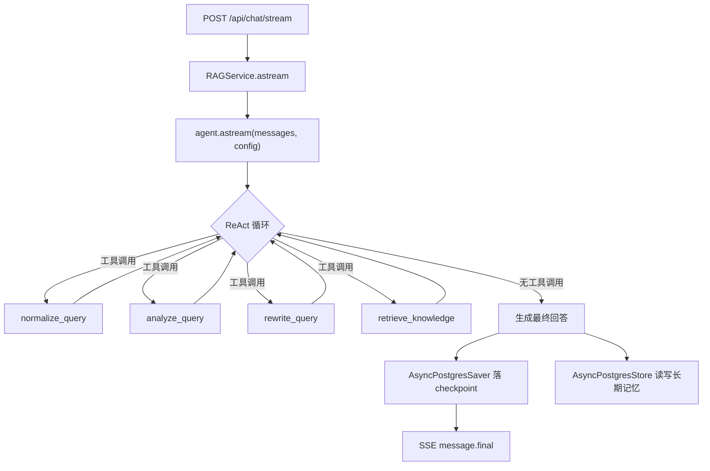

# e-help Agent 化重构设计文档

本文档基于当前代码（`backend/src/e_help/rag.py`、`chains/*`、`server.py`）制定重构方案：用 LangChain `create_agent()` 替换 `RAGService.answer()` 的手写编排，接入 `checkpointer`（短期记忆）和 `store`（长期记忆），并将 Normalize/Safety+Intent/Rewrite/Retrieval 封装为 Agent 工具。本次只产出设计，不修改运行代码。

## 1. 现状与改造动机

当前 `RAGService.answer()`（`rag.py:129`）是一段线性 Python 代码：

```text
get_or_create_thread
  -> build_query_context (normalize -> safety+intent -> rewrite)
  -> route_query
  -> 按 route 分支: chitchat / tool / rag(retrieve + answer)
  -> 手动 append 消息到 self.threads[thread_id].messages
```

存在的问题：

- `self.threads: dict[str, ThreadState]`（`rag.py:45`）是进程内存，重启或多 worker 部署即丢失/不一致，这一点已在 `docs/memory-implementation-plan.md` 第 1 节记录。
- 分支逻辑（`route == "blocked" / "chitchat" / "tool" / "rag"`）硬编码在 `answer()` 里，新增能力（例如订单查询工具、多轮工具调用）需要继续在这个函数里堆 `if/elif`。
- 没有中断恢复能力：一次请求中途异常，无法从"已完成 intent 分析"这一步继续，只能整条重跑。
- `pyproject.toml` 已声明 `langgraph-checkpoint-postgres`、`langgraph-prebuilt` 等依赖，但完全未使用，属于预留能力未落地。

改造目标：把现有确定性预处理链路（normalize、safety+intent、rewrite、retrieval）封装成 Agent 可调用的工具，交给 `create_agent()` 编排；短期记忆交给 `checkpointer`，长期记忆交给 `store`，两者都使用 PostgreSQL（`DB_URL`，见 `docs/memory-implementation-plan.md` 第 2 节）。

## 2. 总体架构



分层职责：

| 层 | 组件 | 职责 |
| --- | --- | --- |
| 接口层 | `server.py` `/api/chat/stream` | 不变：SSE 协议、断线检测、ping |
| 编排层 | `create_agent()` | 决定何时调用哪个工具、何时直接回答 |
| 工具层 | `tools/*.py`（新增） | 把现有 Chain 包一层 `@tool`，保持确定性逻辑不变 |
| 记忆层 | `checkpointer` + `store` | 短期对话状态 / 跨 thread 长期记忆 |
| 知识层 | Milvus + `RagChain` | 不变 |

## 3. 工具封装

现有四个 Chain（`chains/intent.py` 的 `NormalizeChain`/`IntentChain`、`chains/rewrite.py` 的 `RewriteChain`、`chains/rag.py` 的 `RagChain`）逐一封装为工具，逻辑本身不改：

```python
# backend/src/e_help/agent/tools.py
from langchain_core.tools import tool

from ..chains import IntentChain, NormalizeChain, RagChain, RewriteChain
from ..models import RetrievedContext


def build_tools(
    normalize_chain: NormalizeChain,
    intent_chain: IntentChain,
    rewrite_chain: RewriteChain,
    rag_chain: RagChain | None,
):
    @tool
    def normalize_query(query: str) -> str:
        """规范化用户输入的空格、换行和标点，不改变语义。"""
        return normalize_chain.invoke(query).normalized_query

    @tool
    def analyze_query(normalized_query: str) -> dict:
        """对规范化后的问题做安全检查和意图识别，返回 safety_status、intent、entities、need_retrieval、confidence。"""
        safety, intent = intent_chain.invoke(normalized_query)
        return {
            "safety_status": safety.status,
            "safety_reason": safety.reason,
            "intent": intent.intent,
            "entities": intent.entities.model_dump(exclude_none=True),
            "need_retrieval": intent.need_retrieval,
            "confidence": intent.confidence,
        }

    @tool
    def rewrite_query(normalized_query: str, recent_messages: list[dict]) -> dict:
        """结合最近对话把问题改写成可独立检索的形式；recent_messages 为 [{role, content}, ...]。"""
        from ..models import ChatMessage

        history = [ChatMessage(role=m["role"], content=m["content"]) for m in recent_messages]
        result = rewrite_chain.invoke(normalized_query, history)
        return {
            "contextualized_query": result.contextualized_query,
            "should_retrieve": result.should_retrieve,
        }

    @tool
    def retrieve_knowledge(query: str) -> list[dict]:
        """从 Milvus 知识库检索与问题相关的片段，仅用于电商售后知识问答。"""
        if rag_chain is None:
            return []
        retrieved: RetrievedContext = rag_chain.invoke(query)
        return [chunk.model_dump() for chunk in retrieved.chunks]

    return [normalize_query, analyze_query, rewrite_query, retrieve_knowledge]
```

要点：

- 工具函数只是现有 Chain 的薄包装，`NormalizeChain`/`IntentChain`/`RewriteChain` 内部的本地规范化、联合 Safety+Intent 结构化输出、rewrite 门控和缓存（第一阶段优化的成果）全部保留，不因为改成 Agent 而回退。
- `retrieve_knowledge` 返回 `list[dict]` 而不是 `RetrievedContext`，因为工具的输入输出需要是 LLM 能理解、能序列化的 JSON，不能直接返回 Pydantic 对象给模型。
- 安全阻断（`safety_status == "block"`）不适合完全交给模型自由裁量是否调用工具；建议在 `system_prompt` 中明确规则，并在工具返回后由 Agent 侧再做一次硬编码检查（第 6 节说明）。

## 4. Agent 组装

```python
# backend/src/e_help/agent/build.py
from langchain.agents import create_agent

from ..config import Settings
from .tools import build_tools

AGENT_SYSTEM_PROMPT = """你是电商客服助手。
每次收到用户问题时，必须先调用 normalize_query，再调用 analyze_query。
如果 analyze_query 返回 safety_status=block，直接告知用户无法处理该请求，不要调用其他工具。
如果 intent=chitchat，直接回答，不要检索知识库。
如果 intent=rag 且 need_retrieval=true：
  1. 如果存在历史对话，调用 rewrite_query 获取 contextualized_query；
  2. 调用 retrieve_knowledge 检索知识库；
  3. 只依据检索结果回答，找不到答案时明确说“我不知道”，不要编造。
如果 intent=tool，告知用户该功能暂未开放。
"""


def build_agent(settings: Settings, model, checkpointer, store, tools):
    return create_agent(
        model=model,
        tools=tools,
        system_prompt=AGENT_SYSTEM_PROMPT,
        checkpointer=checkpointer,
        store=store,
    )
```

`RAGService` 改造后的调用方式：

```python
config = {"configurable": {"thread_id": thread_id, "user_id": user_id}}
result = await self.agent.ainvoke(
    {"messages": [{"role": "user", "content": message}]},
    config=config,
)
answer = result["messages"][-1].content
```

`thread_id` 由 `checkpointer` 用来定位这次对话属于哪个"图执行线"；`user_id` 通过 `config["configurable"]` 传入，工具或 middleware 中可用 `ToolRuntime`/`get_config()` 读取，用于长期记忆的 namespace 隔离（见第 5 节）。

## 5. 短期记忆：checkpointer

```python
from langgraph.checkpoint.postgres.aio import AsyncPostgresSaver

async with AsyncPostgresSaver.from_conn_string(settings.db_url) as checkpointer:
    await checkpointer.setup()
    ...
```

`checkpointer` 自动做的事情：

- 每次 `agent.ainvoke()` 后，把当前 `messages` 状态和执行位置存到 PostgreSQL，按 `thread_id` 分区。
- 下一次同一个 `thread_id` 调用时，自动把历史 `messages` 注入模型上下文，不需要再手动维护 `self.threads[thread_id].messages`。
- 中途异常可以从最近一个 checkpoint 恢复，而不是整条重跑。

这与 `docs/memory-implementation-plan.md` 中设计的 `conversation_threads`/`conversation_messages` 表是两套独立存储（详见该文档第 4.4 节的对比表）：

- **checkpoint 表**（LangGraph 自动建表管理）：存图执行状态，服务内部使用，不面向产品查询。
- **`conversation_messages`**：面向产品的会话列表、审计、导出、按用户查看历史，仍需要单独维护。

本次重构建议：Agent 调用完成后，仍然在 `RAGService` 里异步写一份 `conversation_messages`，只是不再用它做"读取历史注入 Prompt"这件事——那件事交给 checkpointer 自动处理。两者不冲突，职责不同。

## 6. 长期记忆：store

```python
from langgraph.store.postgres.aio import AsyncPostgresStore

async with AsyncPostgresStore.from_conn_string(settings.db_url) as store:
    await store.setup()
```

用法与 `docs/memory-implementation-plan.md` 第 5 节的 `user_memories` 表方案对齐，但存储介质从自定义表换成 `store` 的 namespace/key 模型：

```python
namespace = ("users", user_id, "memories")
await store.aput(namespace, "response_language", {"value": "简体中文", "confidence": 0.95})
items = await store.asearch(namespace)
```

建议把"是否要写长期记忆"仍然作为独立的确定性工具或 Agent 之外的异步任务，而不是让主 Agent 在每轮对话里自由决定是否调用"记住这句话"的工具：

- 原因：长期记忆写入需要走"结构化抽取 -> 置信度阈值 -> 敏感信息过滤"的规则校验（`memory-implementation-plan.md` 5.3 节），这是确定性规则，不应该完全交给模型自由裁量。
- 做法：在 `message.final` 发出后，另起一个后台任务调用 `MemoryExtractionChain`（结构化输出，非 Agent 工具），校验通过后再 `store.aput`。
- 主 Agent 在回答前，可以调用一个只读工具 `recall_user_memory(user_id)` 从 `store` 里取回少量长期记忆注入 Prompt，但不给它写权限。

```python
@tool
def recall_user_memory(user_id: str) -> list[dict]:
    """查询该用户已确认的长期偏好，仅用于个性化表达，不能作为知识库事实。"""
    ...
```

这样"读长期记忆"是 Agent 工具，"写长期记忆"是独立的确定性后台流程，避免模型在对话中意外触发写入。

## 7. 安全边界：Agent 化之后如何不退化

当前 `router.py` 的硬编码路由（`blocked`/`chitchat`/`tool`/`rag`）在 Agent 化后变成了 Prompt 里的自然语言规则，这是本次改造**风险最高**的点：模型有可能不严格遵守"先 normalize 再 analyze"或"block 就不再调用其他工具"的约束。

缓解措施：

1. **保留硬校验层**：在 `analyze_query` 工具内部，如果 `safety_status == "block"`，直接把工具返回结果设为一个明显的终止信号，并在 `system_prompt` 强调"看到 block 必须立即结束，不能调用检索或回答产品问题"。
2. **加一层 middleware**（`create_agent` 支持 `middleware` 参数）：在模型产生最终回答前拦截一次，如果发现 `analyze_query` 曾返回 `block` 但最终回答不是拒绝话术，强制替换为 `SAFETY_BLOCK_MESSAGE`（复用 `prompts/answer.py` 中已有的常量）。
3. **保留 `RetrievedContext` 空结果时的兜底**：`retrieve_knowledge` 返回空列表时，Prompt 要求必须回答"我不知道"，不能编造，这与当前 `rag.py:150` 的 `if not retrieved.chunks: answer = "我不知道"` 语义一致，只是从 Python 分支变成 Prompt 约束 + 可选 middleware 校验。

## 8. 与 SSE 事件协议的兼容

当前前端依赖的事件（`thread.created`、`intent.completed`、`rewrite.completed`、`retrieval.completed`、`message.delta`、`message.final`，见 `chat-app.tsx:107-134` 和 `rag.py:198-226`）需要继续发送，否则前端状态提示（"正在检索并回答"等）会失效。

`create_agent` 的 `astream()`/`astream_events()` 会产出工具调用事件流，需要在 `RAGService` 里做一次事件映射：

```text
Agent 工具调用 normalize_query 完成      -> 不单独转发（当前协议没有 normalize.completed）
Agent 工具调用 analyze_query 完成        -> 转发为 intent.completed
Agent 工具调用 rewrite_query 完成        -> 转发为 rewrite.completed
Agent 工具调用 retrieve_knowledge 完成   -> 转发为 retrieval.completed
Agent 产出最终 AIMessage                -> 转发为 message.delta + message.final
```

实现方式是遍历 `agent.astream(..., stream_mode="updates")` 产出的每个节点更新，按工具名分发到对应的 `_sse_event()` 调用，`server.py` 的 SSE 循环结构（`asyncio.create_task` + 超时 ping，`server.py:99-155`）不需要改动，只是 `stream_answer()` 内部的事件来源从"手写 yield"变成"翻译 Agent 事件流"。

## 9. 落地阶段

沿用 `docs/memory-implementation-plan.md` 第 9 节的阶段划分，本文档是其"阶段三：按需接入 Agent checkpoint/store"的具体展开：

### 阶段 A：工具化（不接 checkpointer/store，验证行为等价）

1. 新增 `backend/src/e_help/agent/tools.py`，封装四个现有 Chain。
2. 新增 `backend/src/e_help/agent/build.py`，用 `InMemorySaver` + `InMemoryStore`（开发态）组装 `create_agent()`。
3. 新增对比测试：同一批问题分别跑旧 `RAGService.answer()` 和新 Agent，比较 `intent`、`route`、最终是否检索、是否拒绝这几个关键字段是否一致。
4. 暂不切流量，只在测试环境验证。

### 阶段 B：接入 PostgreSQL checkpointer

1. `Settings` 增加 `db_url`（与 `memory-implementation-plan.md` 2 节一致）。
2. 服务启动时创建 `AsyncPostgresSaver`，调用 `setup()`。
3. `RAGService` 内部持有 `self.agent`，`answer()`/`stream_answer()` 改为调用 `agent.ainvoke`/`agent.astream`。
4. `conversation_messages` 表继续写（用于产品侧查询），但不再作为 Prompt 历史来源。
5. 验收标准复用 `memory-implementation-plan.md` 第 10 节："服务重启后同一 thread_id 仍能读取历史并正确处理指代消解"，现在这个能力由 checkpointer 原生提供。

### 阶段 C：接入 PostgreSQL store 和只读长期记忆工具

1. 创建 `AsyncPostgresStore`，调用 `setup()`。
2. 新增 `recall_user_memory` 只读工具，接入 Agent。
3. 后台异步任务负责 `MemoryExtractionChain` 抽取和写入，不经过 Agent 工具调用路径。
4. 验收标准复用 `memory-implementation-plan.md` 第 10 节长期记忆相关条目。

### 阶段 D：安全与协议收尾

1. 补充第 7 节的 middleware 校验，跑一批"应被拦截"的对抗性问题，确认 block 场景不被绕过。
2. 补充第 8 节的事件映射，确认前端 SSE 状态提示不回归。
3. 压测多轮工具调用场景下的延迟，确认没有比第一阶段优化（合并 Safety+Intent、条件 Rewrite、本地 normalize）之前更慢——工具化本身不应引入额外的模型调用次数。

## 10. 本次改造不涉及的部分

- `chains/answer.py` 的 `AnswerChain`（最终生成话术的 LCEL 链）本次不封装成工具，直接作为 Agent 的底层 `model` 生成能力使用；如果后续要支持"生成回答前再调用一次工具"的多轮工具场景，`create_agent` 的 ReAct 循环天然支持，无需额外改动。
- `knowledge.py`、`milvus_store.py`、`retrieval.py` 对应的 Milvus 索引构建流程不变，`retrieve_knowledge` 工具只是套了一层现有的 `RagChain`。
- 前端 `chat-app.tsx` 不需要改动，只要后端保持 SSE 事件名称和 payload 结构不变（第 8 节）。
