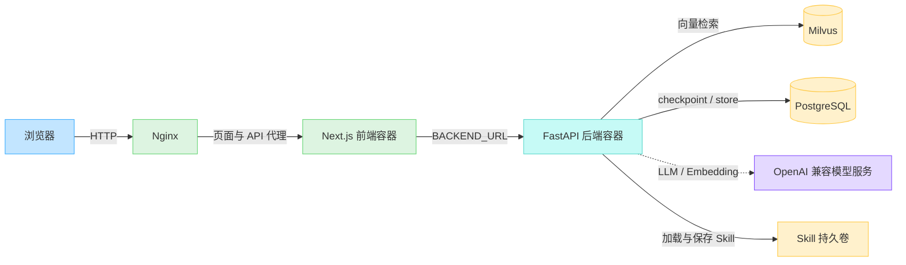

# 项目整体流程图

本文档整理 `电商帮帮` 当前项目的整体请求链路，覆盖前端、Next.js 代理、FastAPI 后端、Agent/RAG 编排、知识库、记忆与 SSE 返回。

## 主流程图

```mermaid
flowchart LR
    user([用户提问])
    chatUi["浏览器聊天页<br/>frontend/app/chat-app.tsx"]
    nextProxy["Next.js Route Handler<br/>app/api/*"]
    fastapi["FastAPI 服务<br/>backend/src/e_help/server.py"]
    threadDecision{"是否已有 thread_id"}
    createThread["创建或恢复会话"]
    ragService["RAGService.stream_answer"]
    agent["LangGraph Agent"]
    normalize["normalize_query<br/>规范化输入"]
    analyze["analyze_query<br/>安全检查与意图分析"]
    routeDecision{"意图路由"}
    blocked["安全拦截回答"]
    chitchat["闲聊回答"]
    toolUnavailable["工具能力暂未开放"]
    recallMemory["recall_user_memory<br/>读取表达偏好"]
    rewrite["rewrite_query<br/>改写检索问题"]
    retrieveDecision{"需要检索知识库?"}
    unknown["返回我不知道"]
    retrieve["retrieve_knowledge"]
    embedding["生成 query embedding"]
    milvus[(Milvus 知识库)]
    retrievedContext["整理 RetrievedContext"]
    llmAnswer["基于检索结果生成回答"]
    postgres[(PostgreSQL<br/>checkpointer/store)]
    sse["SSE 事件返回<br/>message.delta / message.final"]
    render["前端解析事件并展示答案"]
    finish([用户看到回答])

    user --> chatUi
    chatUi -->|"POST /api/threads"| nextProxy
    chatUi -->|"POST /api/chat/stream"| nextProxy
    nextProxy -->|"转发到 BACKEND_URL"| fastapi
    fastapi --> threadDecision
    threadDecision -->|"否"| createThread
    threadDecision -->|"是"| ragService
    createThread --> ragService
    ragService --> agent
    agent --> normalize
    normalize --> analyze
    analyze --> routeDecision
    routeDecision -->|"blocked"| blocked
    routeDecision -->|"chitchat"| chitchat
    routeDecision -->|"tool"| toolUnavailable
    routeDecision -->|"rag"| recallMemory
    recallMemory --> rewrite
    rewrite --> retrieveDecision
    retrieveDecision -->|"否"| unknown
    retrieveDecision -->|"是"| retrieve
    retrieve --> embedding
    embedding --> milvus
    milvus --> retrievedContext
    retrievedContext --> llmAnswer
    blocked --> sse
    chitchat --> sse
    toolUnavailable --> sse
    unknown --> sse
    llmAnswer --> sse
    postgres -.->|"恢复会话与长期记忆"| ragService
    ragService -.->|"写入检查点与消息"| postgres
    sse --> render
    render --> finish

    style user fill:#C2E5FF,stroke:#3DADFF
    style finish fill:#C2E5FF,stroke:#3DADFF
    style chatUi fill:#DDF4E1,stroke:#66D575
    style nextProxy fill:#DDF4E1,stroke:#66D575
    style fastapi fill:#C6FAF6,stroke:#5AD8CC
    style ragService fill:#C6FAF6,stroke:#5AD8CC
    style agent fill:#E4D9FF,stroke:#874FFF
    style normalize fill:#E4D9FF,stroke:#874FFF
    style analyze fill:#E4D9FF,stroke:#874FFF
    style recallMemory fill:#E4D9FF,stroke:#874FFF
    style rewrite fill:#E4D9FF,stroke:#874FFF
    style retrieve fill:#E4D9FF,stroke:#874FFF
    style llmAnswer fill:#E4D9FF,stroke:#874FFF
    style milvus fill:#FFF1CC,stroke:#FFC943
    style postgres fill:#FFF1CC,stroke:#FFC943
    style sse fill:#CDF4D3,stroke:#66D575
    style render fill:#CDF4D3,stroke:#66D575
    style blocked fill:#FFCDC2,stroke:#FF7556
    style unknown fill:#FFCDC2,stroke:#FF7556
    style threadDecision fill:#FFECBD,stroke:#FFC943
    style routeDecision fill:#FFECBD,stroke:#FFC943
    style retrieveDecision fill:#FFECBD,stroke:#FFC943
```



## 关键模块

| 模块 | 位置 | 作用 |
| --- | --- | --- |
| 聊天界面 | `frontend/app/chat-app.tsx` | 管理 user_id、thread_id、输入框、消息列表与 SSE 事件解析 |
| Next.js 代理 | `frontend/app/api/chat/stream/route.ts`、`frontend/app/api/threads/route.ts` | 将浏览器请求转发到后端，避免开发环境 CORS 问题 |
| FastAPI 服务 | `backend/src/e_help/server.py` | 提供健康检查、会话创建、知识库重建、Skill 管理与聊天流式接口 |
| RAGService | `backend/src/e_help/rag.py` | 统一编排会话、幂等请求、Agent 调用、检索、回答与事件输出 |
| Agent 工具 | `backend/src/e_help/agent/tools.py` | 暴露 normalize、analyze、rewrite、retrieve、recall memory 等工具 |
| Agent 构建 | `backend/src/e_help/agent/build.py` | 创建 LangGraph/LangChain Agent，并注入系统提示词、工具、checkpointer 与 store |
| 知识库 | `backend/src/e_help/milvus_store.py`、`backend/src/e_help/retrieval/milvus.py` | 连接 Milvus，执行向量检索 |
| 记忆与检查点 | `backend/src/e_help/agent/memory.py` | 使用 PostgreSQL 保存 LangGraph checkpoint 与长期记忆 |
| Skill 管理 | `backend/src/e_help/skills/registry.py` | 加载、安装、启用、停用和删除动态 Skill |

## 正常 RAG 请求时序

```text
用户输入
  -> 前端 POST /api/chat/stream
  -> Next.js 代理转发
  -> FastAPI 创建 SSE 响应
  -> RAGService 创建或恢复 thread
  -> Agent 调用 normalize_query
  -> Agent 调用 analyze_query
  -> intent=rag 时调用 recall_user_memory
  -> 调用 rewrite_query 生成 contextualized_query
  -> 调用 retrieve_knowledge 访问 Milvus
  -> 基于检索片段生成回答
  -> 写入消息与 checkpoint
  -> SSE 返回 message.delta 和 message.final
  -> 前端展示 assistant 消息
```

## 分支说明

| 分支 | 触发条件 | 当前行为 |
| --- | --- | --- |
| `blocked` | 安全检查不通过 | 直接返回无法处理的安全提示，不再检索知识库 |
| `chitchat` | 判断为闲聊 | 不访问 Milvus，直接自然回答 |
| `tool` | 判断为工具型请求 | 返回功能暂未开放提示 |
| `rag` | 需要基于知识库回答 | 改写问题、检索 Milvus、基于上下文回答 |
| 无检索上下文 | 不需要检索或没有召回结果 | 按约束返回“我不知道” |

## 部署视角



更细的 Query 执行细节见 [RAG MVP 用户 Query 执行流程](rag-query-flow.md)。
