# RAG MVP 用户 Query 执行流程

本文档描述当前程序从用户输入 Query 到返回大模型答案的实际执行路径。

## 主流程图

```mermaid
flowchart TD
    userQuery["用户输入 Query"]
    frontend["前端 ChatApp"]
    proxy["Next.js Route Handler 代理"]
    api["FastAPI POST /api/chat/stream"]
    validate{"消息是否为空或超长"}
    reject["FastAPI 返回 422"]
    connected{"客户端已断开"}
    stop["停止 SSE 生成"]
    threadCheck{"是否已有 thread_id"}
    createThread["创建内存会话"]
    threadEvent["发送 thread.created"]
    stream["RAGService.stream_answer"]
    worker["线程池执行同步 answer"]
    history["读取历史并保存用户消息"]

    userQuery --> frontend
    frontend --> proxy
    proxy --> api
    api --> validate
    validate -->|"是"| reject
    validate -->|"否"| connected
    connected -->|"是"| stop
    connected -->|"否"| threadCheck
    threadCheck -->|"否"| createThread
    createThread --> threadEvent
    threadCheck -->|"是"| stream
    threadEvent --> stream
    stream --> worker
    worker --> history
    history --> normalize

    subgraph preprocessing["预处理与意图分析"]
        normalize["Normalize Chain\n结构化 NormalizeResult"]
        safety["Safety Check\n结构化 SafetyResult"]
        intent["Intent Analysis\n结构化 IntentResult"]
        confidence{"confidence < 0.65"}
        context["构建 QueryContext"]

        normalize --> safety
        safety --> intent
        intent --> confidence
        confidence -->|"是"| forceRag["强制路由为 rag\nneed_retrieval=true"]
        confidence -->|"否"| context
        forceRag --> context
    end

    context --> route{"Intent Router"}

    subgraph chitchatPath["chitchat 路径"]
        chitchatAnswer["Chitchat Answer Prompt"]
    end

    subgraph ragPath["rag 路径"]
        rewrite["Contextual Rewrite\n最多使用最近 6 条消息"]
        retrieve["Milvus Retrieval Chain"]
        embedQuery["Embedding Query\ntext-embedding-3-small"]
        milvus["Milvus\n数据库 e_help_db\ncollection e_help_after_sale"]
        retrievedContext["RetrievedContext\n最多 top_k=5"]
        retrievalCheck{"是否需要检索"}
        resultCheck{"是否召回 chunk"}
        ragAnswer["RAG Answer Prompt"]

        rewrite --> retrievalCheck
        retrievalCheck -->|"否"| unknownPath
        retrievalCheck -->|"是"| retrieve
        retrieve --> embedQuery
        embedQuery --> milvus
        milvus --> retrievedContext
        retrievedContext --> resultCheck
        resultCheck -->|"否"| unknownPath
        resultCheck -->|"是"| ragAnswer
    end

    toolPath["tool 路径\n返回未配置提示"]
    blockedPath["blocked 路径\n返回安全拦截提示"]
    unknownPath["无检索上下文\n返回我不知道"]
    saveAssistant["保存 assistant 消息"]
    intentEvent["发送 intent.completed"]
    rewriteEvent["发送 rewrite.completed\n仅 rag"]
    retrievalEvent["发送 retrieval.completed\n仅检索成功"]
    deltaEvent["发送 message.delta"]
    finalEvent["发送 message.final"]
    errorEvent["发送 error"]
    browser["前端解析 SSE 并展示答案"]

    route -->|"blocked"| blockedPath
    route -->|"chitchat"| chitchatAnswer
    route -->|"tool"| toolPath
    route -->|"rag"| rewrite
    ragAnswer --> saveAssistant
    chitchatAnswer --> saveAssistant
    blockedPath --> saveAssistant
    toolPath --> saveAssistant
    unknownPath --> saveAssistant

    route --> intentEvent
    rewrite --> rewriteEvent
    retrievedContext --> retrievalEvent
    saveAssistant --> deltaEvent
    deltaEvent --> finalEvent
    finalEvent --> browser
    worker -.->|"异常"| errorEvent
    errorEvent --> browser

    style userQuery fill:#C2E5FF,stroke:#3DADFF
    style api fill:#C6FAF6,stroke:#5AD8CC
    style preprocessing fill:#FFF1CC,stroke:#FFC943
    style ragPath fill:#E4D9FF,stroke:#874FFF
    style chitchatPath fill:#DDF4E1,stroke:#66D575
    style validate fill:#FFECBD,stroke:#FFC943
    style connected fill:#FFECBD,stroke:#FFC943
    style route fill:#FFECBD,stroke:#FFC943
    style confidence fill:#FFECBD,stroke:#FFC943
    style retrievalCheck fill:#FFECBD,stroke:#FFC943
    style resultCheck fill:#FFECBD,stroke:#FFC943
    style reject fill:#FFCDC2,stroke:#FF7556
    style stop fill:#FFCDC2,stroke:#FF7556
    style blockedPath fill:#FFCDC2,stroke:#FF7556
    style unknownPath fill:#FFCDC2,stroke:#FF7556
    style finalEvent fill:#CDF4D3,stroke:#66D575
    style browser fill:#CDF4D3,stroke:#66D575
```



## 当前代码中的关键行为

### 1. 请求入口

前端向 `/api/chat/stream` 发起请求。开发环境下请求先经过：

```text
frontend/app/api/chat/stream/route.ts
```

再代理到：

```text
http://127.0.0.1:8000/api/chat/stream
```

### 2. QueryContext 构建

后端依次执行：

```text
Normalize
  -> Safety
  -> Intent
  -> QueryContext
```

`Normalize`、`Safety`、`Intent` 都优先使用 LangChain 的结构化输出和 Pydantic 校验；模型调用失败时使用代码中的降级逻辑。

### 3. 意图路由

| 意图 | 当前处理 |
| --- | --- |
| `chitchat` | 使用 Chitchat Answer Prompt，不检索 Milvus |
| `rag` | Rewrite、Embedding、Milvus 检索、RAG Answer |
| `tool` | 返回“当前暂不支持执行该操作” |
| `blocked` | 返回安全拦截提示 |

当意图置信度小于 `INTENT_CONFIDENCE_THRESHOLD`，默认改为 `rag`。

### 4. RAG 检索

RAG 路径会将上下文重写后的问题向量化，然后访问：

```text
数据库：e_help_db
Collection：e_help_after_sale
模型：text-embedding-3-small
默认维度：1536
默认 top_k：5
```

检索结果统一封装为 `RetrievedContext`，再放入以下边界中交给回答 Prompt：

```text
<retrieved_context>
检索到的 chunk 内容
</retrieved_context>
```

Answer Prompt 要求只能根据该上下文回答。没有可用上下文时直接返回：

```text
我不知道
```

### 5. SSE 返回事件

正常 RAG 请求的事件顺序为：

```text
intent.completed
rewrite.completed
retrieval.completed
message.delta
message.final
```

闲聊请求不会发送 `rewrite.completed` 和 `retrieval.completed`。

安全拦截和 Tool 未配置请求也会发送 `intent.completed`，然后直接发送答案事件。

### 6. 当前 SSE 的实际流式粒度

当前 `RAGService.stream_answer()` 会使用 `run_in_threadpool()` 执行同步的完整 `answer()`。因此：

```text
同步完成 Normalize、Intent、Rewrite、Retrieval、Answer
  -> 一次性发送 message.delta
  -> 发送 message.final
```

这已经避免阻塞 FastAPI 事件循环，但 `message.delta` 目前是整段答案，不是大模型 token 逐字流式。后续如需真正 token 级流式，需要把 `AnswerChain` 改为异步 `astream()`，并在生成器中逐个转发模型 chunk。
