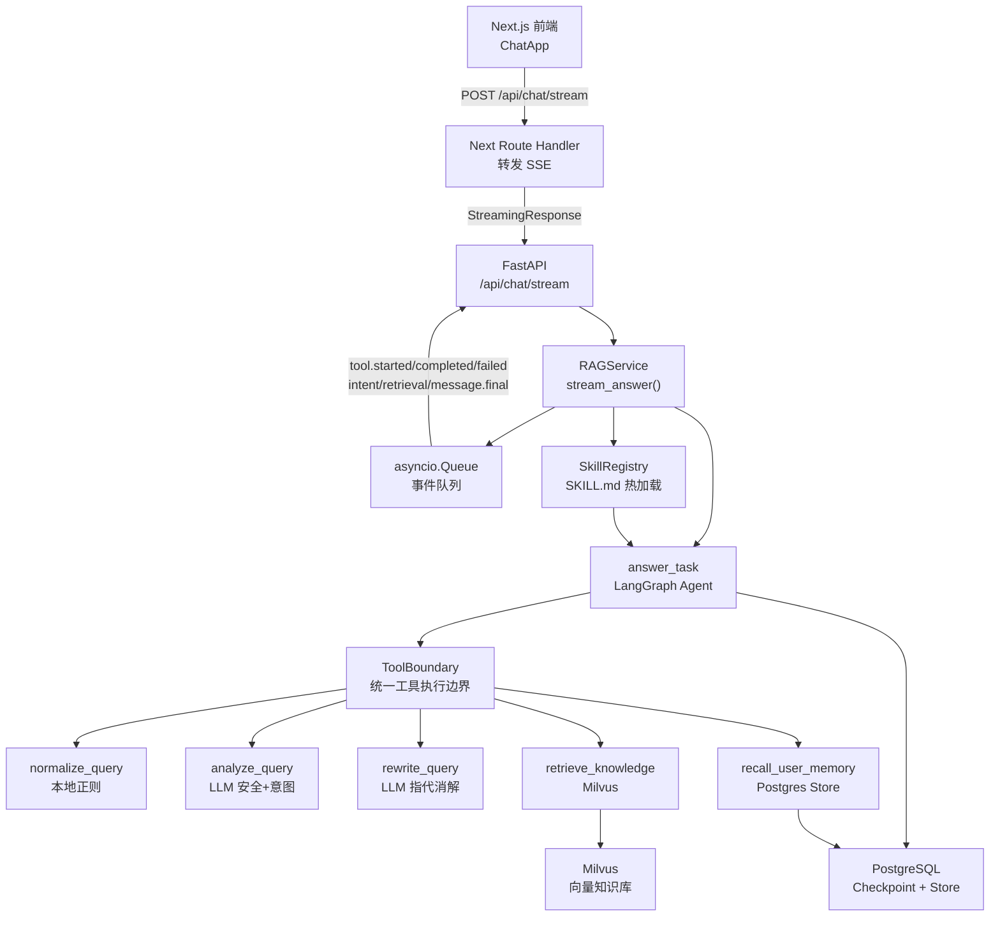
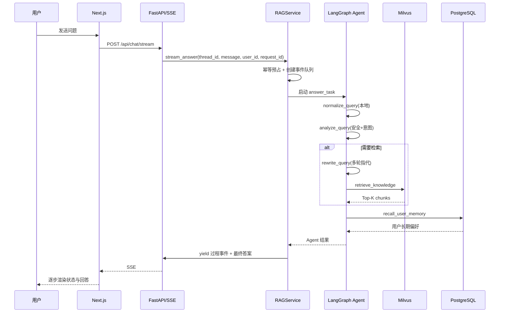

# 电商帮帮：AI 电商客服助手 — 面试讲解文档

> 这份文档的目标：用 1 分钟讲清楚“项目是什么”，用 5～10 分钟讲清楚“为什么这么设计、我解决了什么问题、哪里最有技术含量”。

---

## 1. 一句话介绍

这是一个面向电商售后场景的 **AI 客服助手**，后端用 **FastAPI + LangGraph Agent + RAG**，前端用 **Next.js 16**。它不只是“问一句、查一段、答一句”，而是一个带有 **工具编排、会话记忆、长期偏好、安全路由、SSE 实时过程反馈、可热更新的业务 Skill** 的生产化雏形。

---

## 2. 项目定位与业务背景

电商客服的问题通常不是单纯闲聊，而是：

- “这个套餐能退吗？”
- “企业版最多支持多少人？”
- “发票怎么开？”
- “那第二个套餐呢？”（多轮追问）

所以系统需要同时解决四件事：

1. **理解**：这句话是闲聊、知识库问答，还是要执行外部动作？
2. **检索**：从产品知识库找到唯一可信的答案证据。
3. **记忆**：跨轮次记住用户身份、偏好，同时不能把记忆当事实。
4. **可靠地调用 Agent**：工具调用不能无限重试、不能重复执行、不能阻塞整个服务。

---

## 3. 技术栈

| 层 | 技术 |
|---|---|
| 前端 | Next.js 16（App Router）、React 19、TypeScript、Tailwind CSS v4 |
| 后端 | Python 3.13、FastAPI、Uvicorn、Pydantic |
| Agent | LangGraph + LangChain `create_agent` |
| LLM | OpenAI 兼容服务（可切换 DeepSeek / CloseAI 代理） |
| Embedding | OpenAI 兼容 `text-embedding-3-small` |
| 向量库 | Milvus（Cosine 向量检索） |
| 关系库 | PostgreSQL（LangGraph Checkpoint + Store，长短期记忆） |
| 部署 | Docker Compose + Nginx，支持无源码镜像交付 |

---

## 4. 整体架构



---

## 5. 核心请求链路



---

## 6. 项目最独特、最能体现工程能力的地方

### 6.1 不是“裸调 LangChain”，而是给 Agent 加了一套“工具执行边界”

Agent 最容易在生产环境出问题的地方是：

- 工具调用没有超时；
- 失败后无限重试；
- 模型反复调用同一个工具；
- 工具返回结果过长，把上下文撑爆；
- 客户端断开后后台任务还在跑。

我在 `backend/src/e_help/agent/runtime.py` 里实现了 `ToolBoundary`，把每次工具调用统一包裹成：

```text
检查取消事件
  → 检查幂等签名 / 结果缓存
  → 扣减工具预算
  → 发送 tool.started 事件
  → 限时执行
  → 分类异常
  → 指数退避 + 随机抖动重试
  → 截断返回结果
  → 发送 tool.completed / tool.failed
```

关键设计：

- **预算限制**：`RunBudget` 同时限制模型调用次数和工具调用次数，不是只依赖 LangGraph 的 `recursion_limit`。
- **重复调用去重**：用“工具名 + 参数 JSON 签名”做缓存和去重，同一签名超过 2 次直接拒绝，避免模型重复触发副作用。
- **错误分类**：超时、瞬时错误、内部错误分开处理；检索失败会标记 `trace.unavailable`，最终返回“服务暂不可用”，而不是误导模型“我不知道”。
- **结果截断**：字符串、列表、对象统一限制长度，避免一次检索返回超大文本污染上下文。
- **可观测事件**：每次工具的开始、成功、失败都会产生结构化事件，供 SSE 实时推给前端。

### 6.2 用 `asyncio.Queue` 把“Agent 计算”和“SSE 推送”解耦

在 `backend/src/e_help/rag.py` 的 `stream_answer()` 中，Agent 计算是一个协程，SSE 推送是另一个协程：

- 工具侧用 `event_queue.put_nowait()` 非阻塞地生产事件；
- 消费侧用 `asyncio.wait({get_event, answer_task}, FIRST_COMPLETED)` 同时等待“新事件”和“Agent 完成”；
- 如果 Agent 先完成，就主动取消还挂在 `get()` 上的 Task，避免协程永久挂起。

这样前端能实时看到 `tool.started`、`retrieval.completed` 等过程状态，而不是等到最后才一次性返回。

> 当前版本的过程事件是实时的，最终答案仍是整段通过 `message.delta` / `message.final` 返回完整内容；**token 级流式输出是明确的后续优化点**。这一点在面试时我会主动说清楚，避免被追问。

### 6.3 请求幂等：同一个 `request_id` 不会重复执行

在 `RAGService._reserve_request()` 中：

1. 用 `user_id + thread_id + message` 计算 `sha256` 指纹；
2. 首次出现的 `request_id` 会创建请求记录并成为“拥有者”；
3. 同一个 `request_id` 再次到达时，如果不是拥有者，就等待已存在的 `done` 事件，复用同一份结果；
4. 如果同一个 `request_id` 被用于不同消息，则直接报错，避免覆盖。

这解决了网络重试、前端重复点击、反向代理重发等常见的重复执行问题。

### 6.4 四层记忆，而不是简单把历史消息塞进 Prompt

记忆分成了多层，并由 PostgreSQL 中的 LangGraph Store 承载：

| 记忆层 | 实现 | 生命周期 | 作用 |
|---|---|---|---|
| 会话状态 | LangGraph Checkpointer | thread 级 | 恢复 Agent 多轮状态 |
| 最近消息窗口 | `memory_recent_message_limit` | 会话内 | 处理指代与上下文 |
| 会话摘要 | 结构化 LLM 摘要 | thread 级 | 长对话压缩 |
| 长期偏好 | 结构化记忆点提取 | user 级 | 个性化表达 |

关键约束：

- 长期记忆按 `user_id` 使用独立 namespace，`("users", user_id, "memories")`；
- 会话摘要按 `thread_id` 使用独立 namespace，`("threads", thread_id)`；
- 记忆提取有置信度阈值（低于 0.75 不保存）；
- 会过滤 API Key、密码、订单号、手机号、身份证等敏感信息；
- 记忆写入在后台异步执行，用强引用 + `done_callback` 防止 Task 被 GC，也不阻塞主请求。

更重要的是：**Prompt 里明确区分“记忆”和“知识”**。长期记忆只用于个性化表达，不用于回答产品政策；如果记忆与知识库冲突，以检索结果为准。这能显著降低“把用户说过的话当成事实”的幻觉风险。

### 6.5 安全不是一个 Prompt，而是多层防线

1. **意图 + 安全联合分析**：一次结构化 LLM 调用同时返回 `safety_status`、`intent`、`entities`、`confidence`。
2. **低置信度降级**：意图置信度低于阈值时，默认按 RAG 处理，避免误判成闲聊。
3. **规则 fallback**：LLM 调用失败时，本地启发式规则会兜底，识别高风险词和简单意图。
4. **路由隔离**：`router.py` 把请求分为 `blocked / chitchat / rag / tool`，被拦截或需要外部动作的请求不会进入知识库回答。
5. **外部内容不可信**：检索结果、历史消息、Skill 指令都作为“数据”放在 Human Message 中，不作为 System 指令。
6. **动态 Skill 的 SSRF 防护**：网络 Skill 只允许 HTTPS，且会解析 DNS 并拒绝私网、回环、链路本地、保留地址。

### 6.6 动态 Skill：不重新发版就能调整业务规则

项目实现了 `backend/src/e_help/skills/registry.py`：

- 用 `SKILL.md` + YAML frontmatter 描述一个业务 Skill；
- 支持本地目录和 HTTPS 地址安装；
- 运行时可以通过管理 API 安装、启用、停用、删除、重载；
- 启用的 Skill 会被注入 Agent 的 system prompt。

这解决了一个真实痛点：**业务规则经常变化，但每次改规则都重新发版太重**。运维可以通过管理接口热更新售后话术规范。

安全设计包括：

- 管理接口要求 `X-Admin-Token`，并用 `hmac.compare_digest` 做常量时间比较；
- 网络 Skill 只接受 HTTPS，并限制为文本内容；
- 本地 Skill 只能读取 `SKILL_LOCAL_ROOTS` 配置目录，防止路径穿越。

---

## 7. 后端关键文件地图

| 文件 | 作用 |
|---|---|
| `backend/src/e_help/server.py` | FastAPI 路由、SSE、健康检查、Skill 管理接口 |
| `backend/src/e_help/rag.py` | 核心服务编排、请求幂等、Agent 调度、记忆更新 |
| `backend/src/e_help/agent/build.py` | LangGraph Agent 构建与系统 Prompt |
| `backend/src/e_help/agent/runtime.py` | 工具边界、预算、重试、事件追踪 |
| `backend/src/e_help/agent/tools.py` | 五个 Agent 工具定义 |
| `backend/src/e_help/agent/memory.py` | PostgreSQL 连接池、Checkpoint、Store、长期记忆与摘要 |
| `backend/src/e_help/chains/intent.py` | 本地 normalize + LLM 意图分析 + fallback |
| `backend/src/e_help/chains/rewrite.py` | 多轮指代消解，只在需要时调用 LLM |
| `backend/src/e_help/milvus_store.py` | Milvus Collection 管理、去重、向量写入与检索 |
| `backend/src/e_help/skills/registry.py` | SKILL.md 加载、安装、热更新、安全校验 |
| `backend/src/e_help/router.py` | 安全/意图路由 |
| `backend/src/e_help/config.py` | 所有运行参数、超时、预算、连接池配置 |

---

## 8. 面试讲解脚本

### 8.1 1 分钟版

> 我做的是一个 AI 电商客服助手。后端不是简单的“RAG 问答”，而是用 LangGraph 做了一个有状态 Agent。用户问题进来后，先做本地规范化，再让 LLM 联合做安全检测和意图分类；如果需要知识库回答，就做多轮指代改写，然后从 Milvus 检索；回答时还会带上会话摘要和用户长期偏好。为了保证 Agent 在生产环境可用，我给每个工具调用统一加了超时、预算、重试、去重、结果截断和事件追踪，并通过 SSE 实时推给前端。记忆用 PostgreSQL 的 LangGraph Checkpoint 和 Store，区分会话状态、最近消息、会话摘要和长期偏好。项目还支持通过 SKILL.md 热更新业务规则，不用重新发版。

### 8.2 5 分钟版

1. **背景和目标**：电商售后场景，多轮对话、知识库问答、个性化表达。
2. **整体链路**：FastAPI → LangGraph Agent → 工具编排 → Milvus/PostgreSQL。
3. **第一个重点：Agent 可靠性**。讲 `ToolBoundary` 如何解决超时、重试、重复调用、预算、结果截断。
4. **第二个重点：记忆设计**。讲四层记忆、namespace 隔离、记忆与知识分离。
5. **第三个重点：SSE 过程事件**。讲 `asyncio.Queue` 解耦、心跳、断开取消。
6. **第四个重点：安全与热更新**。讲安全路由、Prompt Injection 防护、动态 Skill。
7. **收尾**：诚实说明当前边界和后续演进方向。

---

## 9. 常见面试追问与回答要点

### Q1：为什么用 LangGraph，而不是直接写一个 RAG Pipeline？

因为场景不只是“检索 + 回答”，还需要 Agent 自主决定调用哪些工具、何时检索、何时读记忆。LangGraph 自带 Checkpoint 和 Store，能方便地做有状态多轮 Agent；同时我可以在工具层自己加边界控制，而不是把可靠性完全交给框架。

### Q2：你的 RAG 为什么可信？

- 检索结果被明确标记为“唯一允许使用的证据”；
- 找不到证据时回答“我不知道”，而不是编造；
- 记忆只用于表达偏好，不作为知识事实；
- 知识库写入时做内容哈希去重，避免重复 chunk。

### Q3：如果 Milvus 挂了怎么办？

- 启动时 Milvus 失败不会让服务直接崩掉，`index_ready` 标记为 false；
- 检索失败会标记 `trace.unavailable`，最终返回“服务暂不可用”；
- `/api/health` 暴露 `index_ready` 和 `index_error`，方便健康检查。

### Q4：如果 PostgreSQL 连接断了怎么办？

`MemoryManager` 使用自愈连接池：

- 池初始化失败会显式超时；
- 健康检查失败时自动重建连接池；
- 记忆读取/写入失败时会降级，不影响主问答流程；
- `is_connection_error()` 会穿透异常链识别 psycopg 连接错误。

### Q5：Agent 无限循环怎么办？

四道防线：

- `agent_recursion_limit`；
- `agent_max_model_calls`；
- `agent_max_tool_calls`；
- 同一工具签名重复调用上限。

### Q6：你的 SSE 稳定吗？

- 工具事件通过队列解耦；
- 每秒检查客户端是否断开；
- 空闲时发送 ping 保持连接；
- Agent 提前结束时会主动取消等待事件的任务。

---

## 10. 当前边界与后续演进方向

面试时主动讲边界，会显得更真实、更成熟。

**已经实现：**

- Agent 工具编排与可靠性控制；
- Milvus 向量检索；
- PostgreSQL 长短期记忆；
- 安全与意图路由；
- SSE 过程事件；
- 请求幂等；
- 动态 Skill 热更新；
- Docker 部署与镜像打包。

**后续可以继续做：**

- token 级流式输出；
- Hybrid Retrieval（BM25 + Dense Vector + RRF/Rerank）；
- 真正的业务工具执行与人工确认机制；
- 用户认证与更严格的多租户权限控制；
- OpenTelemetry + Prometheus + Grafana 可观测性；
- 会话摘要触发、记忆更新策略的压测与调优。

---

## 11. 演示入口

- 前端：`http://localhost:3000`
- 后端健康检查：`http://localhost:8000/api/health`
- 演示视频：`docs/test.mov`

本地启动：

```bash
cd backend
uv sync
uv run uvicorn e_help.server:app --reload --port 8000
```

```bash
cd frontend
npm install
npm run dev
```
